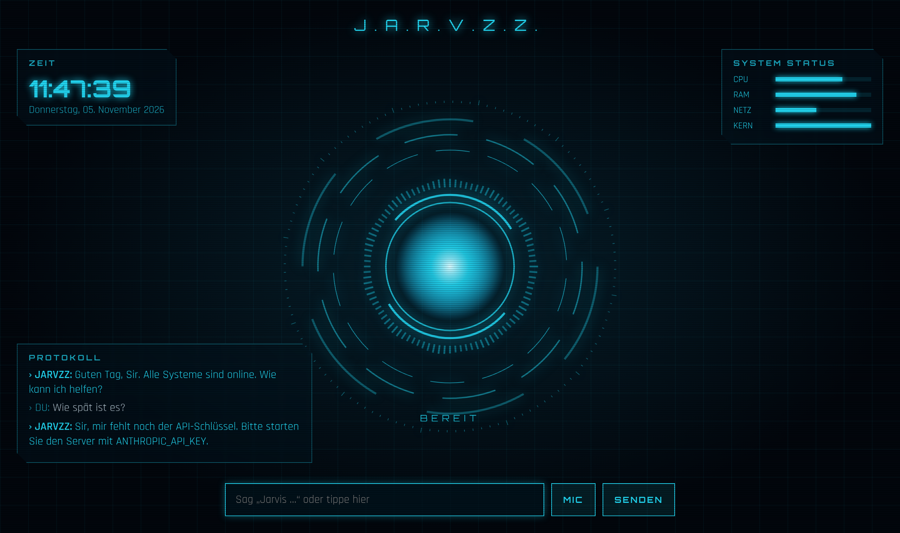

# Jarvzz
Yusuf und Markos eigener Jarvzz – ein KI-Assistent im J.A.R.V.I.S.-Stil mit Arc-Reactor-HUD, Weckwort „Jarvis“, deutscher Sprachein- und -ausgabe und Claude als Gehirn.



## Starten
Voraussetzung: Node.js 18 oder neuer. Es gibt keine Abhängigkeiten zu installieren.

```bash
ANTHROPIC_API_KEY=sk-ant-... node server.js
```
Unter Windows (PowerShell):
```powershell
$env:ANTHROPIC_API_KEY="sk-ant-..."; node server.js
```
Danach **http://localhost:3000** in Chrome oder Edge öffnen und auf „System starten“ klicken.

## Bedienung
- **MIC** einschalten und „Jarvis, wie wird das Wetter?“ sagen; nur „Jarvis“ allein liefert „Ja, Sir?“
- Fragen lassen sich auch unten eintippen.
- Der Orb reagiert auf deine Stimme beim Zuhören, dreht sich schneller beim Nachdenken und pulsiert beim Sprechen.

Das Modell lässt sich mit `JARVZZ_MODEL` ändern (Standard: `claude-sonnet-5-5`).
